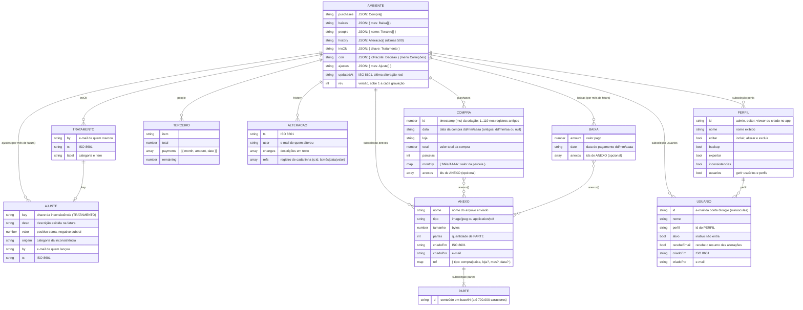

# CPC – Modelo de dados

> Documentos: modelo em PDF com diagrama entidade-relacionamento (`MODELO_DE_DADOS.pdf`) e dicionário de dados (`DICIONARIO_DE_DADOS.pdf` e `DICIONARIO_DE_DADOS.csv`), nesta mesma pasta.

Banco: **Cloud Firestore**, projeto Firebase `cartao-491a2`.
Cada ambiente é um documento da coleção `data`; os dados financeiros ficam em campos desse
documento (gravados como texto JSON) e os comprovantes em uma subcoleção.

| Ambiente | Documento | Site |
|---|---|---|
| Produção | `data/main` | https://dkovags.github.io/controle-cartao/ |
| Homologação | `data/homolog` | https://dkovags.github.io/controle-cartao/homolog/ |

## Diagrama



## Documento do ambiente (`data/main`, `data/homolog`)

| Campo | Tipo gravado | Conteúdo |
|---|---|---|
| `purchases` | texto (JSON) | lista de **Compra** |
| `baixas` | texto (JSON) | objeto cujas chaves são meses de fatura (`"Outubro/2026"`) e os valores, listas de **Baixa** |
| `people` | texto (JSON) | objeto cujas chaves são nomes de pessoas e os valores, listas de **Terceiro** (aba hoje oculta) |
| `history` | texto (JSON) | lista de **Alteração**, da mais antiga para a mais recente; guarda as 500 últimas |
| `incOk` | texto (JSON) | objeto de inconsistências marcadas como tratadas (chave → **Tratamento**) |
| `corr` | texto (JSON) | correções do menu **Correções** já decididas: id do pacote → `{ status: aplicada\|recusada, titulo, by, ts }`; os pacotes ficam em `correcoes/` no repositório |
| `ajustes` | texto (JSON) | objeto cujas chaves são meses de fatura e os valores, listas de **Ajuste** de inconsistência (somados ao total da fatura) |
| `updatedAt` | texto | data e hora (ISO 8601, UTC) da última alteração real dos dados |
| `rev` | inteiro | versão do documento; a gravação só é aceita se ninguém gravou antes (controle de concorrência) |

Os campos são gravados como texto JSON por compatibilidade com a versão original do app.

### Compra

```json
{ "id": 1792101424257, "data": "14/10/2026", "loja": "Bem Mulher", "total": 29940.63,
  "parcelas": 6,
  "monthly": { "Outubro/2026": 4990.11, "Novembro/2026": 4990.11, "Dezembro/2026": 4990.11,
               "Janeiro/2027": 4990.11, "Fevereiro/2027": 4990.11, "Março/2027": 4990.11 },
  "anexos": ["amvbeugg98xrzo"] }
```

- `monthly` usa como chave o **mês da fatura** (competência = mês do pagamento), no formato `Mês/AAAA` com o nome do mês em português.
- Regra de lançamento: compra feita até o dia 18 cai na fatura do próprio mês; a partir do dia 19 (fechamento), na do mês seguinte.
- Compra com entrada (ex.: Iphone) tem um mês a mais que `parcelas`, com o primeiro valor diferente dos demais.

### Baixa (pagamento)

```json
{ "amount": 5750, "date": "13/10/2026", "anexos": ["amvbeuimc3jhdo"] }
```

Fica na lista do mês da fatura a que o pagamento se refere (`baixas["Outubro/2026"]`).

### Alteração (histórico)

```json
{ "ts": "2026-10-16T13:20:05.112Z", "user": "kelianeserra@gmail.com",
  "changes": ["Nova baixa em Outubro/2026: R$ 5.750,00 (13/10/2026) com comprovante"],
  "refs": [["b:Outubro/2026|13/10/2026|5750"]] }
```

`refs` (desde 28/10/2026) diz a que registro cada linha de `changes` se refere: `c:<id da compra>` ou
`b:<mês>|<data>|<valor>` para baixa (numa alteração de baixa, o valor novo e o antigo, para seguir a cadeia).
É o que alimenta o botão 🕘 **Histórico** de cada compra e baixa; linhas antigas, sem `refs`, são
localizadas pelo texto. A aba **Histórico** lista todas as alterações com filtros (tipo, usuário,
período, busca), impressão/PDF e CSV.

### Tratamento de inconsistência (`incOk`)

Chave: `"<categoria>|<referência>"`, por exemplo `"Parcelas × meses lançados|p51"` (compra id 51)
ou `"Possível baixa duplicada|Agosto/2024|14/08/2024|3000"` (mês, data e valor da baixa).

```json
{ "Parcelas × meses lançados|p51": { "by": "kovags@gmail.com", "ts": "2026-10-16T13:04:00Z",
  "label": "Parcelas × meses lançados: Cheiro de Menina (07/05/2024) – id 51" } }
```

### Ajuste de inconsistência (`ajustes`)

Lançado no menu **Inconsistências** (botão **Lançar ajuste**) para acertar erros do passado na
fatura de um mês escolhido. O valor é o inverso do impacto: o que foi pago a menos entra
positivo (soma à fatura) e o que foi pago a mais entra negativo (abate). Ao lançar, a
inconsistência é marcada como tratada; ao remover o ajuste (✕ em Parcelas do Mês), volta a ficar pendente.

```json
{ "Outubro/2026": [ { "key": "Parcelas × meses lançados|p51",
  "desc": "Parcelas × meses lançados: Cheiro de Menina (07/05/2024) – pago a menos",
  "valor": 1036.67, "origem": "Parcelas × meses lançados",
  "by": "kovags@gmail.com", "ts": "2026-10-20T12:00:00Z" } ] }
```

Os ajustes entram no total da fatura, na dívida total (meses a partir do atual), no relatório mensal e no histórico.

As inconsistências em si não são gravadas: são recalculadas pelo app a partir dos dados.

## Comprovantes (subcoleção `anexos`)

| Caminho | Conteúdo |
|---|---|
| `data/{amb}/anexos/{aid}` | metadados do **Anexo** |
| `data/{amb}/anexos/{aid}/partes/{n}` | **Parte** `n` (0, 1, 2…) do arquivo em base64 |

- Fotos são reduzidas (lado maior 1.600 px, JPEG) antes de gravar; PDFs são gravados como enviados (até 8 MB).
- O arquivo é dividido em partes porque cada documento do Firestore aceita no máximo 1 MiB.
- A compra ou baixa guarda os ids em `anexos`; ao excluir o registro, o anexo é mantido (auditoria).

## Usuários e perfis (subcoleções `usuarios` e `perfis`)

Cada ambiente tem o seu cadastro, gerido no menu **Usuários** (só para quem tem a permissão
"Gerir usuários"). Assim, testes na homologação não afetam o acesso à produção.

| Caminho | Conteúdo |
|---|---|
| `data/{amb}/usuarios/{email}` | **Usuário**: nome, perfil, ativo, recebe e-mail |
| `data/{amb}/perfis/{id}` | **Perfil**: nome e permissões |

Perfis iniciais:

| id | Nome | Editar | Backup | Exportar | Inconsistências | Gerir usuários |
|---|---|---|---|---|---|---|
| `admin` | Administrador | ✓ | ✓ | ✓ | ✓ | ✓ |
| `editor` | Edição | ✓ | — | — | — | — |
| `viewer` | Consulta | — | — | — | — | — |

- Consultar os dados é permitido a todo usuário ativo; as permissões acima são adicionais.
- **Administrador de reserva:** `kovags@gmail.com` tem acesso total mesmo que o cadastro seja
  apagado (fixo no código e nas regras). O próprio usuário não pode alterar o seu perfil nem se desativar.
- No primeiro acesso do administrador a um ambiente, o app cria o cadastro inicial
  (perfis acima e os usuários de `ROLES` em `src/index.html`). Até isso acontecer, vale `ROLES`.
- As regras do Firestore (`firestore.rules`) consultam essas mesmas fichas para liberar leitura e gravação.
- Alterações de cadastro entram no histórico do ambiente.

## Correções preparadas pelo Claude (pasta `correcoes/` + campo `corr`)

Correções de dados são preparadas como arquivos JSON na pasta `correcoes/` do repositório
(publicada com o site) e listadas em `correcoes/index.json`, cada uma com o ambiente a que se
destina (`main`, `homolog` ou `ambos`). No menu **Correções** (só administrador), cada pacote
mostra o antes e o depois; ao **Aplicar** ou **Recusar**, a decisão fica em `corr`:

```json
{ "2026-10-17-teste-na": { "status": "aplicada", "titulo": "Teste: loja \"N/A\" passa a \"Não informada\"",
  "by": "kovags@gmail.com", "ts": "2026-10-17T16:29:12Z" } }
```

Cada operação do pacote confere o valor esperado (`de`) antes de alterar; se o registro mudou,
o pacote fica bloqueado. Operações: `compra.alterar`, `compra.incluir`, `compra.excluir`,
`loja.renomear`, `baixa.alterar`, `baixa.incluir`, `baixa.excluir` (detalhes em `correcoes/LEIA-ME.md`).
A alteração é gravada com o login de quem aplicou e registrada no histórico.

## Notificação por e-mail

A cada gravação com inclusão, alteração ou exclusão, o app envia as operações para um
Google Apps Script (`email/Code.gs`). O script guarda-as numa fila (Propriedades do script);
a janela é **por usuário**: a primeira operação de cada usuário abre uma janela de 8 horas
dele e, ao fim, um gatilho de tempo envia todas as operações desse usuário no período num
único e-mail (com o nome de quem alterou) aos usuários ativos marcados com **recebe e-mail** no cadastro da produção. Nada disso é gravado no
Firestore. Formato enviado pelo app:

```json
{ "token": "…", "ambiente": "produção", "usuario": "kelianeserra@gmail.com",
  "quando": "2026-10-16T13:20:05Z",
  "ops": [ { "acao": "Inclusão", "tipo": "baixa", "desc": "Fatura Outubro/2026, pago em 13/10/2026",
             "valor": 5750, "anterior": null, "anexo": true } ] }
```
